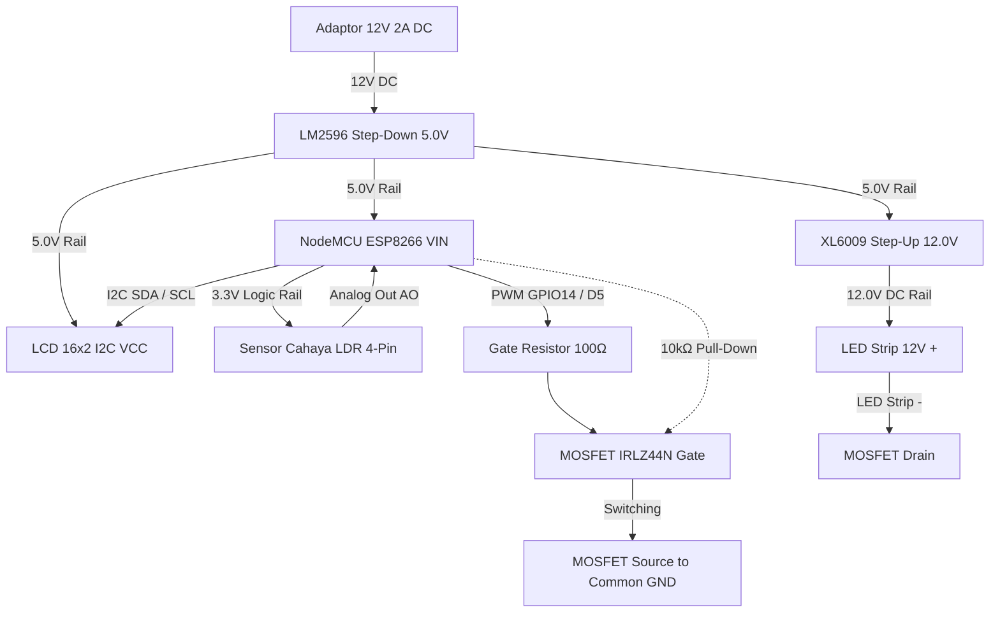

# 💡 GlowUp-IoT: Intelligent Adaptive Lighting & Embedded Web Telemetry

<div align="center">

[](https://platformio.org/)
[](https://arduino-esp8266.readthedocs.io/)
[](https://www.espressif.com/)
[](https://isocpp.org/)
[](#-sistem-kontrol--arsitektur-algoritma)
[](LICENSE)

**Sistem penerangan pintar IoT industri skala mikro dengan kendali adaptif sensorik, closed-loop state machine, dynamic bus arbitration, dan micro-web console mandiri tanpa ketergantungan cloud.**

[Fitur Utama](#-fitur-unggulan) • [Arsitektur Hardware](#-arsitektur-hardware--topologi-daya) • [Algoritma Kontrol](#-sistem-kontrol--arsitektur-algoritma) • [Spesifikasi API](#-restful-api--telemetri-json) • [Panduan Instalasi](#-memulai-quick-start)

</div>

---

## 🚀 Ringkasan Eksekutif (Executive Summary)

**GlowUp-IoT** adalah sistem pencahayaan pintar mandiri (*edge-computing IoT*) yang dirancang menggunakan mikrokontroler **ESP8266 (NodeMCU LoLin V3)**. Sistem ini menggabungkan kendali otomatis berbasis sensor fotometrik (LDR) dan kendali jarak jauh melalui antarmuka web responsif berkecepatan tinggi yang disimpan langsung di dalam memori *Flash* (PROGMEM).

Dibuat dengan standar rekayasa perangkat lunak terapan:
* **Zero-Blocking Architecture**: Seluruh *loop* eksekusi berjalan asynchronously menggunakan penghitung waktu presisi berbasis `millis()`, bebas dari fungsi pemblokir seperti `delay()`.
* **Zero Cloud Dependency**: Perangkat mampu beroperasi sepenuhnya otonom tanpa koneksi internet luar, menjaga privasi lokal dan ketersediaan sistem 100%.
* **Fail-Safe Robustness**: Dilengkapi pengunci keamanan hardware (*Safety Lock*), pengaman *hysteresis* lampu untuk mencegah flicker, serta *auto-fallback* hotspot jika jaringan WiFi primer terputus.

---

## ✨ Fitur Unggulan

### 1. Dual-Core Control Engine
* **Mode Otomatis (Closed-Loop Autonomous)**: Mengatur output pencahayaan secara inversif terhadap intensitas cahaya sekitar menggunakan pembacaan LDR dengan filter adaptif.
* **Mode Manual (Real-Time Web Console)**: Kontrol presisi sakelar daya (ON/OFF) serta peredupan intensitas (*dimming slider* 0–100%) melalui dashboard nirkabel.

### 2. Algoritma Peredupan Halus (Smooth PWM Ramping)
* Transisi intensitas tidak menyentak kasar ke mata, melainkan menggunakan algoritma *linear stepping ramp* 2 poin tiap 100 ms (~5 detik dari mati total hingga kecerahan maksimal 100%).
* Output PWM dikunci pada frekuensi **1.000 Hz** dengan rentang resolusi **10-bit (0–1023)** untuk mengeliminasi fenomena strobing/flickering pada kamera.

### 3. Smart Self-Healing Network
* Sistem mencoba menghubungkan ke WiFi lokal (2.4 GHz). Jika terjadi kegagalan jaringan selama $\ge 15$ detik, subsistem jaringan secara otomatis membangkitkan **Access Point lokal mandiri** (`SmartLight-<ChipID>`) dengan IP statis `192.168.4.1`.

### 4. Zero-Dependency Embedded Web Console
* Antarmuka web modern dengan desain *Midnight Blue & Paper Palette* disimpan terkompresi di memori program mikro.
* Polling status asinkron tiap 750 ms dengan konsumsi bandwidth sangat rendah (~700 byte JSON payload).
* Proteksi request via custom header `X-SmartLight: 1` untuk mencegah eksploitasi form cross-origin (CSRF prevention).

### 5. Dynamic I2C Bus Auto-Discovery
* Inisialisasi bus I2C dilengkapi modul pemindai alamat otomatis (*auto bus-scanner*) pada alamat `0x01` hingga `0x7F`. Driver LCD 16x2 otomatis beradaptasi baik pada chip ekspander `PCF8574T` (0x27) maupun `PCF8574AT` (0x3F) tanpa re-flash firmware.

---

## 📐 Arsitektur Hardware & Topologi Daya

Rangkaian dirancang dengan pemisahan logika kontrol bertegangan rendah (3.3V & 5V) dan beban daya tinggi (12V) menggunakan modul switching converter dan sakelar MOSFET kanal-N *Logic Level*:



### 📌 Pin Mapping NodeMCU LoLin ESP-12E

| Pin Board | GPIO | Fungsi | Komponen Terhubung |
| :---: | :---: | :--- | :--- |
| **A0** | ADC0 | Analog Input (0–1.0V internal divider 3.3V) | Pin AO Sensor LDR |
| **D1** | GPIO5 | I2C Serial Clock (SCL) | Pin SCL Modul Backpack I2C LCD |
| **D2** | GPIO4 | I2C Serial Data (SDA) | Pin SDA Modul Backpack I2C LCD |
| **D5** | GPIO14| High-Speed Hardware PWM (1 kHz) | Gate MOSFET IRLZ44N (via Resistor 100Ω) |
| **3V3** | - | Suplai Tegangan Referensi 3.3V | VCC Sensor LDR *(Wajib 3.3V untuk proteksi A0)* |
| **VIN** | - | Suplai Masukan Utama 5.0V | Output LM2596 OUT+ |
| **GND** | - | Ground Referensi | Common Ground Rangkaian |

---

## 🧠 Sistem Kontrol & Arsitektur Algoritma

### 1. Exponential Moving Average (EMA) Sensor Filter
Untuk menghindari fluktuasi acak akibat *noise* pembacaan ADC atau bayangan sesaat:

$$S_t = \alpha \cdot X_t + (1 - \alpha) \cdot S_{t-1}$$

Dengan koefisien pemulusan $\alpha = 0.15$ pada interval sampling $150\text{ ms}$, respons sensor menjadi sangat stabil dan natural.

### 2. Dual-Threshold Hysteresis
Mencegah fenomena *hunting/flicker* (lampu hidup-mati cepat saat kondisi cahaya berada di ambang batas):
* **Lampu Aktif (Turn ON)**: Jika tingkat cahaya lingkungan $\le 70\%$.
* **Lampu Mati (Turn OFF)**: Jika tingkat cahaya lingkungan $\ge 85\%$.
* **Zona Histeresis ($71\% - 84\%$)**: Status output sebelumnya dipertahankan (*latch*).

---

## 📡 RESTful API & Telemetri JSON

ESP8266 mengekspos endpoint HTTP internal ringan untuk telemetri dan kendali:

### GET `/api/status`
Mengembalikan status lengkap sistem dalam format JSON:
```json
{
  "mode": "AUTO",
  "adc": 384,
  "light": 62,
  "sensorReady": true,
  "calibrated": true,
  "lamp": true,
  "brightness": 38,
  "target": 38,
  "manualBrightness": 50,
  "manualOn": false,
  "pwm": 389,
  "outputEnabled": true,
  "wifi": true,
  "ap": false,
  "ip": "192.168.1.105",
  "uptime": 1420,
  "lcd": true
}
```

### POST `/api/mode`, `/api/lamp`, `/api/brightness`
Endpoint kendali membutuhkan header keamanan: `X-SmartLight: 1` dengan payload format `application/x-www-form-urlencoded`.

---

## 💻 Memulai (Quick Start)

### Prasyarat
* [Visual Studio Code](https://code.visualstudio.com/) + Ekstensi **PlatformIO IDE**
* Driver USB Serial **CH340** (untuk board NodeMCU LoLin V3)

### Kloning & Kompilasi
```bash
# 1. Kloning repositori
git clone https://github.com/USERNAME/glowup-iot.git
cd glowup-iot

# 2. Setup konfigurasi jaringan (opsional)
cp include/secrets.example.h include/secrets.h

# 3. Kompilasi firmware
pio run

# 4. Upload ke board (sambungkan kabel USB)
pio run -t upload

# 5. Buka Serial Monitor (115200 baud)
pio device monitor -b 115200
```

> 📖 **Panduan Perakitan & Kalibrasi Fisik:**
> Baca dokumentasi lengkap untuk rekan tim dan perakitan di file [**PANDUAN_PENGGUNAAN.md**](PANDUAN_PENGGUNAAN.md).

---

## 📊 Metrik Efisiensi Memori (Build Verification)

* **Compiler Toolchain**: `xtensa-lx106-elf-g++` (Arduino ESP8266 Core v3.1.2)
* **RAM (Dynamic Heap/BSS)**: **29.9 KB** / 80.0 KB (**36.8%** - Sangat lega, bebas risiko *out-of-memory*)
* **Flash ROM**: **317.4 KB** / 1.04 MB (**30.4%** - Ruang cadangan masih 70% untuk fitur masa depan)

---

## 👨‍💻 Kontributor & Lisensi

Proyek ini dikembangkan secara modular sebagai portofolio teknologi IoT embedded systems. Didistribusikan di bawah lisensi terbuka [MIT License](LICENSE).
